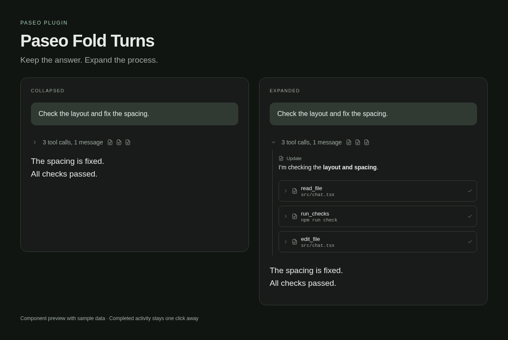

# Paseo Fold Turns

Automatically collapse completed tool calls, thinking, and progress messages
into one expandable row. Keep the final answer visible.



A finished turn becomes a line such as **60 tool calls, 3 messages** above the
answer. Expand it to inspect the process, then collapse it when you are done.
Context compaction notices fold with the process. Final answers retain Paseo's
normal Markdown and answer controls.

## Install

Requires Paseo **>=0.11.2 <0.12.0** on both the daemon and connected app, with
plugins enabled. Node and npm must be available on the daemon host.

```sh
paseo plugin install npm:paseo-fold-turns
```

Or enter `npm:paseo-fold-turns` in **Settings → Plugins → Plugin source**.
The runtime plugin ID is `completed-turns`.

Finished turns fold automatically. Click the process row to expand it. The
**Process** composer button expands or collapses completed turns in the open chat.
Use one timeline-folding plugin at a time.

## What stays visible

Running turns, pending questions and permissions, errors, ambiguous entries, and
incomplete history stay visible. This plugin changes presentation, not the agent's
context or stored conversation.

On desktop and web, expanded turns use the existing Paseo rows. Android and iOS
use one persistent inline process block with selectable Markdown, expandable tool
details, code copying, and additional entries loaded on demand. The final answer
uses Paseo's normal renderer on every platform.

## Data access and limits

The daemon reads the viewed agent's existing timeline through Paseo. The initial
index contains grouping metadata. Expanding a native block sends its selected
process text and tool details to the connected app. Plugin code makes no external
network requests and creates no disk archive of conversations. Clicking a link
opens it with the device's normal handler; images appear as links.

The index reads at most 8,000 projected timeline entries. Native process pages
contain at most 40 entries; individual text fields are limited to 16,000 characters
with a truncation notice. Loaded pages are cached in client memory.

Position preservation uses adapters for Paseo's web virtualizer and React Native
list internals. Compatibility is deliberately limited to Paseo 0.11.x and must be
reviewed for later versions. Automated tests, Hermes compilation, and browser
models cover compatibility; they do not replace testing on physical devices.

## Updates

```sh
paseo plugin update completed-turns --check
paseo plugin update completed-turns
```

Paseo manages the installed version. Publishing a new npm version does not
silently update an installation.

## Development

Use Node 24 and npm 11.

```sh
npm ci --ignore-scripts
npm run typecheck
npm test
npm run check:package
paseo plugin install .
```

The development command installs dependencies before installing the local directory.
The npm package is the supported public installation source.

SDK, React and React Native packages are development dependencies: Paseo provides
the runtime instances. The Markdown parser runs only in the daemon, keeping its
syntax out of Android's Hermes client bundle.

## Releases

The `publish.yml` workflow publishes stable version tags such as `v0.2.1` to npm
using trusted publishing. It runs the checks and publishes the inspected tarball;
it does not connect to any Paseo daemon.

For the first publication, log into npm, run the checks, create an artifact with
`npm pack --ignore-scripts --pack-destination .artifacts`, and publish that tarball
with `npm publish .artifacts/paseo-fold-turns-0.2.0.tgz --access public`. Create the
`.artifacts` directory first. Then configure the npm package's trusted publisher
for `Daaaaave/paseo-fold-turns`, workflow `publish.yml`, with direct publication
allowed. Future releases use a new matching package version and tag.

Do not store npm tokens in repository files. See
[npm trusted publishing](https://docs.npmjs.com/trusted-publishers/) and
[Paseo plugin publishing](https://paseo.sh/docs/plugins/publishing).

## License

MIT.
